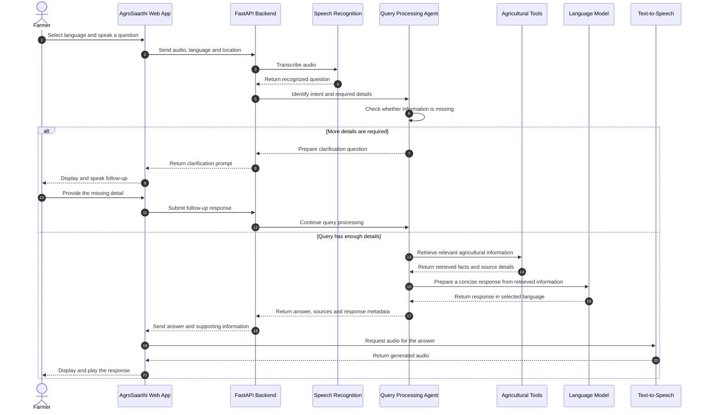
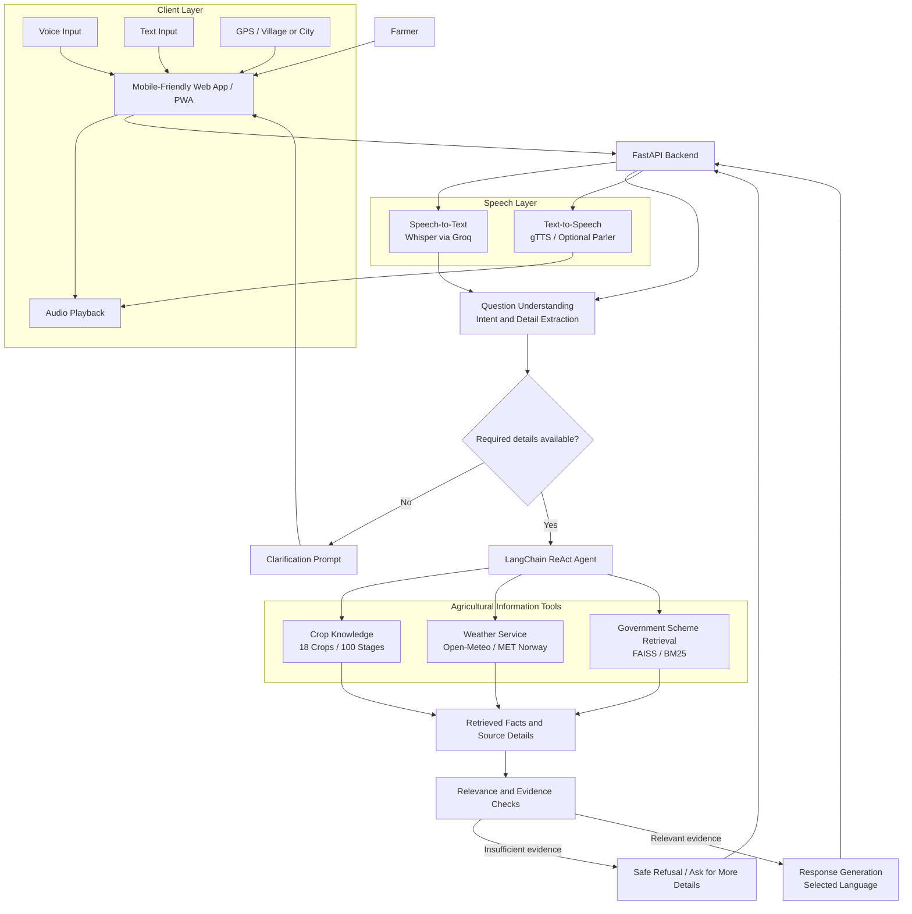

# AgroSaarthi AI — Intelligent Voice-First Multilingual Agricultural Advisory System

**A voice-first agricultural assistant designed to make reliable farming information easier to access for farmers across India.**

AgroSaarthi AI allows farmers to ask agricultural questions using their voice or text and receive short, easy-to-understand responses in their selected language. It brings together crop-related knowledge, weather information, and government-scheme guidance through a conversational interface, with spoken responses to make information more accessible.

The project currently supports **English, Hindi, Punjabi, and Marathi**.

[](https://multilingual-agri-ai-agent.onrender.com)
[](https://colab.research.google.com/github/sehscape/farmer_voice_assisatnt/blob/main/notebooks/run_full_app_colab.ipynb)


---

## Contents

- [Project Overview](#project-overview)
- [Problem Statement](#problem-statement)
- [Project Objectives](#project-objectives)
- [Key Features](#key-features)
- [Supported Languages](#supported-languages)
- [System Workflow](#system-workflow)
- [System Architecture](#system-architecture)
- [Knowledge Sources and Advisory Modules](#knowledge-sources-and-advisory-modules)
- [AI Provider Strategy](#ai-provider-strategy)
- [Safety and Reliability](#safety-and-reliability)
- [Technology Stack](#technology-stack)
- [Getting Started](#getting-started)
- [Configuration](#configuration)
- [Deployment](#deployment)
- [API Reference](#api-reference)
- [Repository Structure](#repository-structure)
- [Current Limitations](#current-limitations)
- [License](#license)

---

## Project Overview

Agricultural information is often spread across technical documents, online portals, weather services, and government resources. Finding the relevant information can take time, particularly when the information is not available in a farmer's preferred language or is difficult to navigate using a phone.

**AgroSaarthi AI** aims to make this information easier to access through a conversational, voice-first interface. A farmer can ask a question, provide additional details when requested, and receive a concise answer in the selected language. The assistant uses dedicated tools and knowledge resources to retrieve information rather than relying only on a language model's general knowledge.

The system is designed around three principles:

1. **Speak naturally:** Farmers can ask questions by voice or text, with spoken responses available in the selected language.
2. **Use grounded information:** Crop guidance, weather updates, and scheme information are retrieved through their respective knowledge sources or services.
3. **Handle uncertainty responsibly:** When required details are missing or retrieved evidence is not sufficiently relevant, the assistant can ask a follow-up question or decline to provide an unsupported answer.

## Problem Statement

To design and develop **AgroSaarthi AI**, an intelligent, voice-first, multilingual agricultural advisory system that enables Indian farmers to access relevant farming information through spoken or text-based queries in selected Indic languages. The system integrates curated agricultural knowledge resources and live data services to retrieve information about crop practices, weather conditions, and government schemes. It then prepares concise, easy-to-understand, source-supported responses in the farmer's selected language and delivers them through text and speech. The solution also aims to improve accessibility through a mobile-friendly interface and lightweight communication options, while using clarification and confidence checks to avoid providing advice when the available evidence is incomplete or unreliable.

## Project Objectives

- Provide a simple way for farmers to ask agricultural questions without depending entirely on typing.
- Support interaction in English, Hindi, Punjabi, and Marathi.
- Retrieve crop guidance and scheme information from curated knowledge resources.
- Connect to weather services for current conditions and forecast information.
- Generate short, readable answers in the language selected by the user.
- Convert responses into speech so farmers can listen to the guidance.
- Ask for missing information when a question does not contain enough context.
- Avoid unsupported recommendations by applying retrieval relevance checks and fallback behaviour.
- Keep the application usable on mobile devices and constrained hosting environments.

## Key Features

| Feature | Description |
|---|---|
| Voice-based questions | Farmers can record a question; speech recognition converts it into text for processing. |
| Multilingual interaction | Supports English, Hindi, Punjabi, and Marathi. |
| Crop advisory | Provides stage-aware guidance for 18 crops across 100 growth stages, including fertilizer, irrigation, and crop-care information. |
| Weather information | Retrieves current weather and a three-day forecast for a village or city. |
| Government scheme information | Searches a curated collection of 10 agricultural and farmer-support schemes. |
| Follow-up questions | Requests missing details, such as crop or crop age, before preparing a more relevant answer. |
| Spoken responses | Converts the generated response into audio, with playback controls. |
| Source-aware answers | Returns source information associated with retrieved advisory content where available. |
| Mobile-friendly interface | Includes a phone-oriented interface, GPS/location support, dark mode, and a Progressive Web App shell. |
| LLM fallback | Uses a secondary language-model provider when the primary provider is unavailable, subject to configured API keys. |

## Supported Languages

| Language | Code |
|---|---|
| English | `en` |
| Hindi | `hi` |
| Punjabi | `pa` |
| Marathi | `mr` |

The selected language is carried through the question-processing workflow so that clarification prompts and final responses can be presented consistently.

---

## System Workflow

The following sequence shows how a voice query moves through the application, from the farmer's microphone to the spoken response.



## System Architecture

This architecture represents the main application components and their responsibilities. The farmer interacts with the web interface, while the backend coordinates speech processing, query understanding, retrieval tools, response generation, and audio output.



### Architecture notes

- The backend coordinates the request and maintains the query state.
- Speech recognition is used to convert recorded questions into text.
- The agent selects the relevant agricultural tool based on the question.
- Crop, weather, and scheme information are handled by separate tools.
- Retrieved information is passed to the response-generation step.
- Clarification and refusal paths help prevent the system from filling gaps with unsupported advice.
- Text-to-speech delivers the final response as audio.

---

## Knowledge Sources and Advisory Modules

The project currently includes three main information modules.

### 1. Crop advisory

The crop knowledge collection covers **18 crops across 100 growth stages**. The guidance includes information such as:

- Fertilizer recommendations by crop stage.
- Irrigation requirements.
- Pest and disease considerations.
- Crop-care notes and practical tips.

| Crop category | Included crops |
|---|---|
| Cereals and millets | Wheat, rice, maize, bajra, jowar |
| Pulses | Chickpea, pigeon pea (tur/arhar), moong |
| Oilseeds | Soybean, mustard, groundnut |
| Cash crops | Cotton, sugarcane |
| Vegetables and fruit | Onion, tomato, potato, chilli, banana |

### 2. Weather information

The weather module can retrieve current conditions and a three-day forecast for a village or city. It uses:

- Open-Meteo for geocoding and forecast information.
- MET Norway as a fallback weather source.
- A 15-minute cache to reduce repeated requests.

The user can provide a location, or the application can request location information when it is needed.

### 3. Government schemes

The scheme collection contains information about 10 farmer-support schemes. Scheme documents are indexed for retrieval using FAISS or BM25, depending on the configured backend.

| Scheme | Information covered |
|---|---|
| PM-KISAN | Income-support scheme information |
| PM Fasal Bima Yojana | Crop insurance information |
| Kisan Credit Card | Agricultural credit information |
| Soil Health Card | Soil testing and nutrient guidance |
| PM-KUSUM | Solar-energy support for agriculture |
| PMKSY – Per Drop More Crop | Micro-irrigation support |
| PM Kisan Maandhan | Pension scheme information |
| e-NAM | Electronic agricultural market information |
| Crop Residue Management | Support related to crop-residue management |
| Namo Shetkari Mahasanman Nidhi | Maharashtra farmer-support scheme information |

Scheme conditions, benefits, and eligibility rules can change. Farmers should confirm current details with the relevant official department or local agricultural office.

---

## AI Provider Strategy

The application supports a primary and fallback provider arrangement for language-model operations.

| Provider | Role in the application |
|---|---|
| **Groq** | Primary speech-recognition and language-model provider. Whisper-large-v3 is used for speech-to-text; configured Groq chat models handle query understanding and response generation. |
| **Google Gemini** | Secondary language-model provider when the primary chat provider is unavailable or rate-limited. |

The configured model names are controlled through environment variables. The exact model used depends on the available provider configuration and API access.

**Important:** Gemini is configured as a language-model fallback; the current voice transcription path uses Groq's Whisper service. If no API key is configured, the application can use its rule-based fallback for supported text workflows, but voice functionality may not be available.

---

## Safety and Reliability

Agricultural guidance can affect crop health, costs, and a farmer's livelihood. For that reason, the system includes checks intended to reduce unsupported responses.

| Safeguard | Purpose |
|---|---|
| Tool-grounded information | Uses the crop, weather, and scheme tools as the information sources for relevant answers. |
| Retrieval relevance threshold | Rejects weak scheme-document matches rather than treating them as reliable evidence. |
| BM25 matching rule | Requires more than a single accidental keyword match for the relevant retrieval path. |
| Clarification prompts | Requests missing information, such as crop details or crop age. |
| Crop-age validation | Helps catch implausible crop-age inputs before advice is prepared. |
| Controlled response generation | Instructs the language model to phrase retrieved facts rather than invent agricultural recommendations. |
| Farm-specific glossary | Helps preserve agricultural terminology during multilingual responses. |
| Script validation and retry | Helps prevent responses from being returned in an unintended writing system. |
| Secret handling | Avoids logging API keys. |

The assistant is an information-support tool, not a replacement for local agricultural experts. Crop recommendations may vary with soil, region, variety, and local conditions. Farmers should verify important decisions with their local Krishi Vigyan Kendra (KVK) or agriculture department.

---

## Technology Stack

| Layer | Technology |
|---|---|
| Frontend | HTML, CSS, JavaScript |
| Browser audio | MediaRecorder and Web Audio |
| Progressive Web App | Service worker and PWA support |
| Backend API | FastAPI and Uvicorn |
| Alternative UI | Gradio 6.26 |
| Agent orchestration | LangChain ReAct AgentExecutor |
| Primary AI provider | Groq |
| Fallback AI provider | Google Gemini |
| Speech-to-text | Whisper-large-v3 via Groq; local Whisper-small option |
| Retrieval | FAISS semantic search and BM25 keyword search |
| Embeddings | `sentence-transformers/paraphrase-multilingual-MiniLM-L12-v2` |
| Translation support | NLLB-200 distilled 600M; IndicTrans2 optional |
| Text-to-speech | gTTS; Indic Parler TTS optional on GPU |
| Weather | Open-Meteo and MET Norway |
| Deployment | Render and Google Colab |

---

## Getting Started

### Prerequisites

- Python 3.11
- Git
- A Groq API key for the primary voice and AI workflow
- A Google Gemini API key if you want to configure the language-model fallback

API keys can be created from:

- [Groq Console](https://console.groq.com)
- [Google AI Studio](https://aistudio.google.com/app/apikey)

### 1. Clone the repository

```bash
git clone https://github.com/sehscape/farmer_voice_assisatnt.git
cd farmer_voice_assisatnt
```

### 2. Create and activate a virtual environment

**Windows PowerShell:**

```powershell
python -m venv venv
venv\Scripts\Activate.ps1
```

**Windows Command Prompt:**

```bat
python -m venv venv
venv\Scripts\activate.bat
```

**Linux / macOS:**

```bash
python3 -m venv venv
source venv/bin/activate
```

### 3. Install dependencies

For the full local build:

```bash
pip install -r requirements.txt
```

### 4. Configure environment variables

Create a local `.env` file from the example:

```bash
cp .env.example .env
```

On Windows, you can also create `.env` manually by copying `.env.example`.

Add the API keys and any required configuration values to `.env`. Do not commit this file or publish API keys.

### 5. Build the scheme retrieval index

Run the index-building script once:

```bash
python scripts/build_scheme_index.py
```

### 6. Start the application

```bash
python app.py
```

Open the application at:

- Main interface: `http://127.0.0.1:7860`
- Classic Gradio interface: `http://127.0.0.1:7860/classic`
- API documentation: `http://127.0.0.1:7860/api/docs`

---

## Configuration

The application reads its configuration from environment variables.

| Variable | Default | Purpose |
|---|---|---|
| `GROQ_API_KEY` | Not set | Groq speech recognition and primary language-model access |
| `GROQ_LLM_MODELS` | Configured model list | Ordered list of Groq chat models to try |
| `GEMINI_API_KEY` | Not set | Google Gemini fallback access |
| `GEMINI_LLM_MODELS` | Configured model list | Ordered list of Gemini models to try |
| `LITE_MODE` | `false` | Enables a lighter configuration for memory-constrained hosts |
| `AGENT_BACKEND` | `langchain` | Selects `langchain` ReAct or `sequential` processing |
| `RAG_BACKEND` | `faiss` | Selects FAISS semantic retrieval or BM25 keyword retrieval |
| `TTS_ENGINE` | `gtts` | Selects `gtts`, optional `parler`, or `stub` |
| `DEV_MODE` | `true` | Enables additional pipeline trace information |

Check `.env.example` and the configuration module for the exact accepted values in the current codebase.

---

## Deployment

### Deploying on Render

The repository includes a `render.yaml` blueprint for the lightweight deployment configuration.

1. Push the project to your GitHub repository.
2. Open [Render](https://render.com).
3. Select **New + → Web Service** and connect `sehscape/farmer_voice_assisatnt`.
4. Allow Render to read the repository's `render.yaml` configuration.
5. Add the required environment variables in the Render dashboard:
   - `GROQ_API_KEY`
   - `GEMINI_API_KEY` (if using the fallback provider)
6. Start the deployment and check the build and runtime logs.

The free Render instance may spin down after a period of inactivity, so the first request after an idle period can take longer.

For additional deployment details, refer to [`DEPLOY.md`](DEPLOY.md).

### Google Colab

The full-build notebook is available here:

[Open AgroSaarthi AI in Google Colab](https://colab.research.google.com/github/sehscape/farmer_voice_assisatnt/blob/main/notebooks/run_full_app_colab.ipynb)

---

## API Reference

The backend exposes endpoints that can be used by the web interface and other compatible clients.

| Endpoint | Method | Input | Purpose |
|---|---|---|---|
| `/api/ask` | `POST` | JSON: `text`, `lang`, `location`, `pending` | Processes a text-based agricultural question. |
| `/api/voice` | `POST` | Multipart audio with `lang`, `location`, `pending` | Transcribes and processes a spoken question. |
| `/api/speak` | `POST` | JSON: `text`, `lang` | Generates speech audio for a response. |
| `/api/config` | `GET` | None | Returns supported languages, UI strings, sample questions, and crop names. |
| `/api/health` | `GET` | None | Reports which application engines are active. |

### Example request

```bash
curl -X POST "https://multilingual-agri-ai-agent.onrender.com/api/ask" \
  -H "Content-Type: application/json" \
  -d '{"text":"My wheat is 40 days old. Which fertilizer should I use?","lang":"hi"}'
```

---

## Repository Structure

```text
farmer_voice_assisatnt/
├── app/
│   ├── agents/          # Query understanding, clarification, agent and reply workflow
│   ├── models/          # Groq, Gemini, STT, TTS, translation and embedding clients
│   ├── rag/             # FAISS semantic search and BM25 retrieval
│   ├── tools/           # Crop, weather and government-scheme tools
│   ├── ui/              # Question pipeline, Gradio UI and language resources
│   ├── web/             # FastAPI server and browser application
│   ├── utils/            # Logging, audio conversion and device utilities
│   ├── knowledge.py      # Crop and scheme knowledge registry
│   ├── config.py         # Environment-based configuration
│   └── main.py           # Application startup
├── data/
│   ├── crops/            # Crop knowledge files
│   └── schemes/          # Scheme data and source documents
├── notebooks/            # Google Colab full-build notebook
├── scripts/              # Index builder, tests and evaluation utilities
├── tests/                # Automated tests
├── app.py                # Application entry point
├── render.yaml           # Render deployment blueprint
├── requirements.txt      # Full dependency set
└── requirements-lite.txt # Lightweight deployment dependencies
```

---

## Current Limitations

- The live deployment uses a shared provider configuration, so usage is subject to the provider's API quotas and rate limits.
- Voice recordings are sent to the configured speech-recognition provider. A production deployment should review data-handling requirements and consider self-hosted speech recognition where appropriate.
- The crop advisory collection currently covers 18 crops and is based on curated general guidance. Local recommendations can differ by soil, region, crop variety, and growing conditions.
- The scheme collection currently contains 10 schemes. Eligibility rules, benefit amounts, and application processes may change and should be checked against current official sources.
- Low-bandwidth and PWA support improve access, but they do not mean that every feature works fully offline. Voice processing and live weather retrieval require network connectivity.
- Language availability and response quality depend on the configured speech, translation, and text-generation components.

---

## Future Scope

Potential areas for further development include:

- Adding more Indic languages and improving regional agricultural vocabulary.
- Integrating additional verified agricultural datasets and official live services.
- Expanding crop coverage and region-specific recommendations.
- Supporting additional low-bandwidth channels, subject to suitable integrations.
- Improving offline access to selected static agricultural resources.
- Adding more extensive evaluation for speech recognition, retrieval quality, response faithfulness, and language quality.
- Introducing stronger evidence tracking and confidence calibration for safety-sensitive recommendations.

---

## License

This project is distributed under the **MIT License**. See the [`LICENSE`](LICENSE) file for details.

---

**AgroSaarthi AI — making useful agricultural information easier to ask, understand, and hear.**
